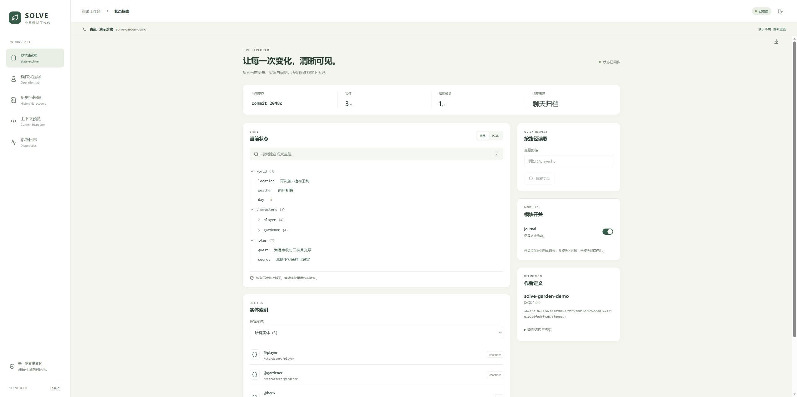

# SOLVE · SillyTavern-Oriented-LLM-Variable-Engine

[](LICENSE)
[](docs/release-guide.md)

面向 **SillyTavern 1.19.x 单角色聊天**的结构化变量引擎。模型输出 JSON 指令，Core 执行与校验，聊天文件保存实际结果。现包含 React + Radix 调试工作台，松绿与暖灰配色，支持浅色/深色以及电脑/手机。



当前预览版为 **0.9.0-preview.1**（预发布）。在 0.9.0-dev 系列（内联作者工具、世界书接入、Facet 生命周期、条件指南、长聊天性能）之上，加入官方数据结构、按结构声明渲染的状态栏、调试面板和结构制作。264 项自动测试通过，当前完成情况与接手任务集中在实施状态中。[当前状态](docs/implementation-status.md)

## 开发与文档入口

| 目的 | 入口 |
| --- | --- |
| 参与开发、分工和提交合并申请 | [协作指南](CONTRIBUTING.md) |
| 编写角色定义、世界书和条件指南 | [作者接入](docs/authoring.md) |
| 查找设计、接口、验收和交付文档 | [文档目录](docs/README.md) |
| 查看长聊天测量与剩余瓶颈 | [性能记录](docs/performance.md) |

## 安装到酒馆

已发布的预览版可从 [Releases](https://github.com/aforgomon41-create/SillyTavern-Oriented-LLM-Variable-Engine/releases/tag/v0.9.0-preview.1) 下载 `SOLVE-native-0.9.0-preview.1.zip`，解压到酒馆自定义扩展目录下的独立 `solve/` 文件夹，确保 `manifest.json` 直接位于该文件夹内。重载酒馆后，右下角会出现 **◈ SOLVE** 入口。作者定义的注册方式见下方“作者入口”。

安装本地开发版时，运行下列构建与打包命令，使用 `artifacts/releases/0.9.0-preview.1/` 中对应分发包。不要将本机验收辅助脚本放进正式扩展。

```sh
npm ci
npm run check:portable
npm run package
npm run test:release
```

原生包解压后的 `solve/manifest.json` 位于扩展根部。动态包托管整个 `solve/`；内嵌包提供酒馆助手脚本 JSON 和入门定义。每包都有 `SOURCE_CODE.zip`，它是本次实际对应源码，不依赖尚未发布的远程标签。

## 先试用调试面板

```sh
npm ci
npm run dev
```

打开终端给出的本机演示链接，默认 `http://127.0.0.1:4173/debug.html?demo=1`。如果端口占用，用环境变量 `SOLVE_DEBUG_PORT` 换端口。

演示使用真实 Core 与 Controller、内存聊天宿主，刷新即重置，不调用模型、不访问真实聊天。`/host-preview.html` 可验证同源嵌入、关闭与未绑定时的只读检查。

- 状态探索：可展开/搜索的状态树、JSON、路径查询、实体与引用、模块和作者约束。
- 操作实验室：JSON 格式提示与格式化、示例、作者输入、预演变更/反馈/状态/别名、绑定基线后正式提交。
- 历史与恢复：旧修订检查、双版本差异、楼层/回复信息、单层和后续重放、归档校验与缓存重建。
- 上下文预览：视图与路径筛选，JSON/TOON/指南/指令/反馈/独立操作提示词，字符和字节统计。
- 诊断：日志搜索与级别过滤、宿主能力、请求取消、本地报告下载、保存失败草稿重试/放弃。

界面里的查询和预演不会保存聊天；正式提交、模块切换与重放会保存。报告里的历史变更可能含变量值，分享前请检查。

## 运行

要求 Node.js 22 或更新版本。

```sh
npm ci
npm run check
npm run test:host
```

`test:host` 默认连接 `http://localhost:11451`，只创建和清理本次 UUID 命名的临时角色及聊天，不调用模型。地址通过 `SOLVE_TEST_URL` 环境变量修改，只允许本机。最新实测结果位于 `test-results/host-1.19.json`。

## 已实现

- Zod 定义编译、会话指纹、开局状态、默认值、异步校验、输入变换与输出校验分离。
- 原十算子、`$valueOf`、五阶段流水线、局部失败隔离。
- `$group` 有序原子组，支持嵌套和完整回退。
- 实体 ID、拥有关系、移动/交换、反向引用及删除清理；初始数据、预制、模板。
- 模块休眠与开启补默认值；TOON/紧凑 JSON 同一投影、双宏输出。
- 不可变历史修订、累计 Patch、Restore、Replay、Greeting 变体与旧分支保留。
- 单会话队列、动作去重、保存失败草稿和迟到请求检查；IndexedDB 派生快照与草稿。
- 酒馆 1.19 保存/回读确认、Swipe 同步、原生请求准入、渲染与提示词过滤。
- 酒馆助手标准变量：楼层按 Swipe 展示操作、双 Patch 与提交信息，聊天保存当前确认快照；旧聊天自动补齐。
- 随正文和独立操作模型模式；独立连接预设、自定义请求函数、超时、取消。
- 作者定义注册与按角色绑定；切聊天自动释放旧控制器并恢复原定义。
- 多文件定义组合、世界书条目编译与实际文件读取、带版本的 Facet 收集、来源诊断与可序列化编译清单；聊天头保存一份固定声明用于冷恢复。
- 浏览器默认启用快照与草稿缓存；草稿重试、放弃与损坏隔离。
- 调试接口：状态/实体/引用、定义与模块、操作预演、历史对比、归档检查、上下文预览和有界日志。
- 原生删除后的恢复与重放；被保留旧修订依赖的已删楼祖先，随存活回复归档。

## group

```json
{"$group":[
  {"$inc":{"@player.gold":-30}},
  {"$move":{"@sword":"@player.inventory"}}
]}
```

任一步失败撤回整组。组内越界直接失败，避免截断数值掩盖余额不足。普通组外 `$inc` / `$set` 按上下限截断；`$transfer` 为保持守恒，在任何位置都不截断。

数组成员按序执行，每个成员内部沿用五阶段。同一对象中先执行普通五阶段，再执行 group；需明确前后顺序时使用顶层有序数组。

## 作者入口

完整示例：`examples/rpg-definition.ts`。核心入口：`src/index.ts`。酒馆入口：`src/host/controller.ts`。

```ts
import { compile, SolveCore, toJson, toToon } from './src/index.js';
import { rpgDefinition, buySword } from './examples/rpg-definition.js';
const definition = await compile(rpgDefinition);
const core = new SolveCore(definition);
const result = await core.execute(buySword, await core.initialize());
console.log(toJson(definition, result.state));
console.log(toToon(definition, result.state));
```

三种分发的配置示例见 [分发与安装](docs/distributions.md)。构建后的 `dist/solve.js` 是浏览器核心 ESM，`sillytavern.js` 是绑定入口，`dynamic.js` 是动态加载器，`embedded.js` 是卡内单文件入口，`index.js` 和 `manifest.json` 是原生扩展；`debug.html`、`debug.js`、`debug.css` 是调试面板，必须一起复制。`rpg-example.js` 是可直接导入的示例定义。

将 `dist/` 文件放进酒馆自定义扩展目录的独立 `solve/` 文件夹，重载后由作者脚本绑定：

```js
// 路径按实际安装位置替换。
const { rpgDefinition } = await import('/scripts/extensions/third-party/solve/rpg-example.js');
const backend = await SOLVE.attach(rpgDefinition);
await backend.submit({$inc:{'@player.hp':-10}});
```

扩展加载不会自动初始化未绑定的角色卡。推荐作者脚本注册固定定义，并明确绑定角色文件名：

```js
await SOLVE.register(rpgDefinition, {
  characters: ['你的角色文件名.png'],
  attach: { mode: 'in-band' }
});
```

注册后切换聊天会自动恢复；旧聊天按定义指纹寻找原版本，缺少时不会自动套用新版。作者脚本仍需在页面加载时运行一次注册。单次手动使用可继续调用 `SOLVE.attach()`；`SOLVE.detach()` 停止自动绑定，后续注册或绑定可重新开启。缓存默认开启，可用 `cache: false` 关闭。

控制器方法：`processMessage(index)` 同步模型回复；`submit(batch,{actionId,index})` 提交玩家动作；`setModule(name,enabled)` 切换模块；`replayMessage(index)` 重算指定楼层；`replayFrom(index)` 重算后续选中楼层；`dispose()` 释放控制器。重试使用相同 actionId，不同点击使用不同编号。

调试与恢复接口的完整说明见 [调试 API](docs/debug-api.md)。扩展加载后，点击酒馆右下角 **◈ SOLVE** 打开面板，也可调用 `SOLVE.openDebugger()`；关闭使用面板按钮或 Escape。样式在同源 iframe 内隔离，关闭后焦点回到入口。没有绑定定义时会显示具体原因，并提供只读归档检查。

## 宏

| 宏 | 内容 |
|---|---|
| `{{solve_toon}}` / `{{solve_json}}` | 完整启用模块状态 |
| `{{solve_toon::narrative}}` / `{{solve_json::narrative}}` | 去除 internal 字段 |
| `{{solve_toon::operator}}` / `{{solve_json::operator}}` | 去除 readonly 长文本 |
| `{{solve_toon::@player.hp, world.weather}}` / 相同参数的 solve_json | 局部投影 |
| `{{solve_val::@player.hp}}` | 单值 |
| `{{solve_SOP}}` / `{{solve_guide}}` / `{{solve_feedback}}` | 指令说明、指南、反馈 |

两种格式使用相同筛选规则，由作者选择。readonly/internal 是披露策略，不是写权限。`@` 只标记投影，真实 Key 不带 @。宏只读已归档且对应选中历史的状态。数组局部投影用 null 占位，保留原下标。

## 作者函数与历史

输入 schema 的 transform/preprocess 只在输入边界运行。改变输出类型时提供纯校验 `outputSchema`；程序无法从任意 JS 函数推断输出约束。`validateState(state,context)` 支持跨字段异步规则，在组的最终候选上校验。函数行为、默认值、闭包捕获值或依赖变化必须更新定义版本；编译阶段不会调用动态默认函数来采样指纹。

时间、随机数、远程结果在调用前准备并以 authorInputs 归档。普通 Replay 复用这些值；Restore 不执行作者函数、模型请求或外部写入。外部副作用不在变量回退保证内。

聊天元数据保存 Genesis 和共享校验/执行上下文；楼层变量按 Swipe 保存唯一的不可变提交修订，消息元数据只保留短指针，各回复 HEAD 按指针恢复。旧格式在打开时自动无损转换。清缓存后可离线恢复；缓存不能掩盖归档损坏。

## 酒馆助手变量

更新引擎并刷新酒馆后，在酒馆助手的变量面板展开 `solve`：

| 位置 | 字段 | 内容 |
| --- | --- | --- |
| 楼层变量 | `solve.operations` | 此回复的有序动作记录，含来源与操作指令 |
| 楼层变量 | `solve.dataPatch` / `solve.enginePatch` | 数据与引擎状态的实际变化 |
| 楼层变量 | `solve.commit` | 短提交编号、父提交、校验索引与绑定 |
| 楼层变量 | `solve.feedback` / `solve.aliases` | 执行反馈与实体别名 |
| 聊天变量 | `solve.data` / `solve.engineState` | 当前已确认的数据快照与引擎状态 |
| 聊天变量 | `solve.headId` / `solve.stateHash` / `solve.ready` | 快照对应提交、校验值和是否可用于当前聊天 |

切换回复会同步活跃快照；预演不写入。保存失败时保留上次确认状态，并将内存中的 `ready` 标为 false。旧聊天自动迁移，不重跑模型操作或增加提交。0.8.3 的楼层 `solve.version` 为 3，是唯一正式记录；空的 `enginePatch`、反馈与别名省略，旧修订放在 `history`，默认动作类型/来源省略。完整内容可用 `SOLVE.controller.inspectCommit(solve.commit.id)` 查看，支持短编号。聊天快照只保留 data、engineState、headId、stateHash、ready 和必要时的 reason，会话身份从状态 API 获取。请通过操作 API 修改正式状态。脚本读取方式见 [调试 API](docs/debug-api.md#酒馆助手标准变量)。

## 当前边界

已验证 1.19.0 单聊。原生拦截器覆盖原生生成入口，不承诺拦住助手或第三方自行联网。服务端没有版本比较后原子写入接口；浏览器锁与回读协调 SOLVE 实例，第三方绕过队列保存仍可能竞争。

已支持内联作者声明、Facet编译/投影/保存后回调、registerWorldInfo固定恢复和按状态条件选择指南；指南正文热更新、宿主关键词触发、不同版本引擎共存和复杂查询仍待推进。保存后回调异步执行，后续操作基线变化时明确拒绝；恢复不重发外部通知，不提供跨进程通知送达保证。已完成 Node 大数据/长历史测量，浏览器、IndexedDB、控制器和真实保存的规模验收仍未完成。调试工作台已实现；面向玩家的状态栏和作者可视化制作工具仍属后续范围。

实施规范：`docs/backend-design.md`。实施与验证进度见 [当前交付](docs/implementation-status.md)。主企划保留原文件名。

## 开源协议

从 **0.7.1** 开始，本项目采用 **[GNU AGPL v3，仅限第 3 版（AGPL-3.0-only）](LICENSE)**，具有强互惠性（通常称“开源传染力”）：分发修改版或构成同一程序的衍生作品时，需按协议提供对应源码并保留相同许可；修改版若支持通过网络与用户交互，还须向这些用户显著提供免费获取该版本对应源码的机会。协议允许商用。

源码与构建入口见本仓库，面板页脚提供源码及协议链接。独立作品仅与本项目一同存放、普通聊天数据或单纯使用本项目，并不会因此自动全部改为 AGPL；具体范围以协议正文为准。分发或部署修改版时，应提供自己的实际对应源码，不能只链接未修改的上游版本。详见 [授权与版本说明](docs/licensing.md)。

**已发布的 0.7.0 曾采用 Apache-2.0，已授出的许可无法追溯撤回。** 其标签与历史安装包保留原许可；当前版本和后续版本以各自声明为准。

第三方依赖继续遵循各自协议。浏览器构建包中的 `THIRD_PARTY_NOTICES.txt` 保留所包含依赖的授权内容，项目声明见 [NOTICE](NOTICE)。
