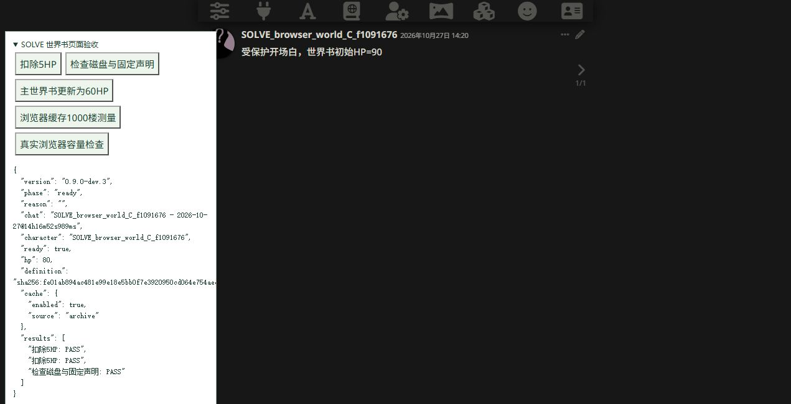
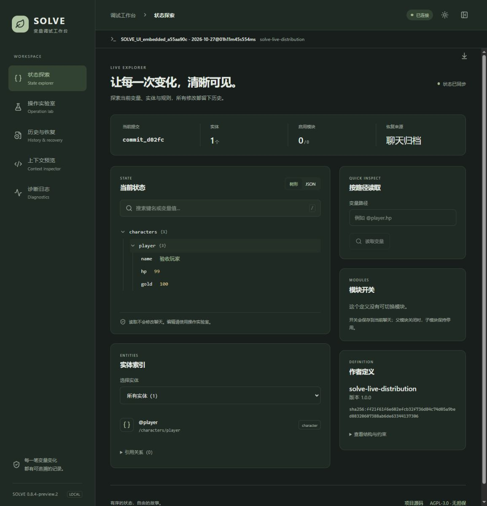
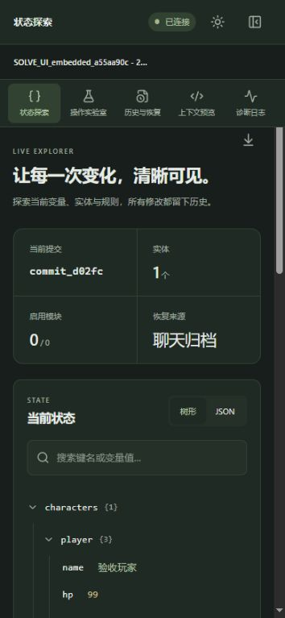
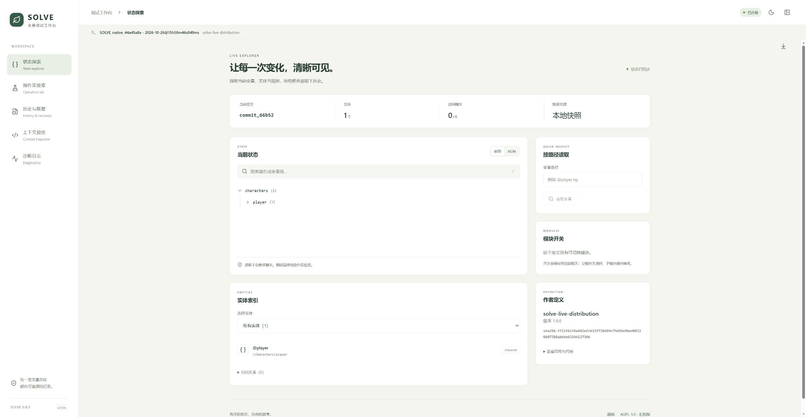
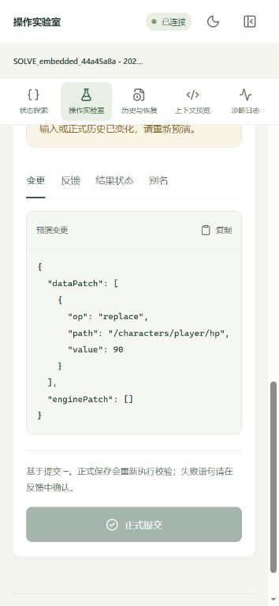

# SOLVE 引擎与调试面板验证记录

## 2026-11-08 官方数据结构与引擎新能力（claude/dev）

环境：本机测试酒馆 SillyTavern 1.19.0 + 酒馆助手 4.11.3，假模型（卡密预设仓库 `test/mock-llm/server.mjs`）按脚本排队回复；SOLVE 以原生扩展安装（dist 复制到 third-party/solve）。脚本 `scripts/live-official.mjs` 创建随机命名的测试角色，通过真实发送消息、生成、保存、刷新和重新生成完成检查，结束后删除角色及聊天。

| 视口 | 结果 |
| --- | --- |
| 电脑 1440×900 | 21/21 通过 |
| 手机 390×844 | 21/21 通过 |

覆盖：绑定官方结构；轮次等于楼层号；关键事件自动盖轮次；新角色自动补齐默认值与空缺属性；好感度单次变化截断；模型写轮次被拒绝；清单到预警线后整理指令进入模型实际收到的提示词；到上限拒绝新增；玩家设置与互斥组切换在刷新后从聊天恢复；迁移指令进入实际提示词且只出现一次；超凡计算值进入提示词、休眠体系不进入；不在场角色与社交的声明式投影；重新生成同一楼层轮次不变；背景音乐按场景情绪选曲并在点击后播放；刷新后轮次恢复；页面无 SOLVE 错误（刷新瞬间被中断的 3 条酒馆助手请求另计）。

自动检查：`npm run check:portable` 通过（类型检查、245 项 Node 回归、三载体构建与构建包运行）。尚未覆盖：真实模型连接、独立操作模型模式、动态导入与卡内单文件两种载体。

## 2026-11-08 协作基线整理

开发基线为0.9.0-dev.8。本次整理贡献指南、文档目录、当前状态和PR模板，并将协作指南及其链接页面加入源码包与运行分发包。

提交前从Git暂存树导出独立源码副本，复用当前锁文件对应的本机依赖，执行check:portable、package和test:release。验证范围包括235项Node回归、类型检查、三载体构建、构建包运行、协作文档链接及安装包内容。本机记录位于test-results/collaboration-baseline/。

本次整理沿用下文按版本、日期记录的实机与性能证据。协作者克隆后可按照贡献指南执行自动检查，并生成自己的性能或实机报告。[协作指南](../CONTRIBUTING.md)

## 0.9.0-dev.8 第一轮增量认证（未发布）

2026-10-28。235项自动检查、类型检查、三载体构建和构建包运行检查通过，日志为test-results/dev8-final-check.log。新增11项回归覆盖完整proof字节等价、最近祖先后缀、返回/输入隔离、相同ID/最终摘要下的旧历史损坏、不同会话与声明、清理竞态、容量、伪造状态、同楼修订/追加、正式Controller共享及保存候选冻结。另检查假认证器、子类覆盖与假计时器不能跳过真实恢复；清理或替换运行实例时不污染共享认证。公开restore仍全链检查；缓存声明不能自行绕过验证。

完整Controller基准使用同一批1,000/5,000楼、约94KB状态夹具；两个版本串行独立进程，均一次同楼预热、每种操作3个样本。每次计时后独立完整恢复磁盘归档，前后请求数、提交数量和状态摘要逐项一致。结果和方法见performance.md、test-results/commit-pipeline-dev8-final-comparison.json；这些是Node和JSON HTTP替身数据，不是实机结果。

DSH专项只读审查使用用户允许的opendesign / deepseek-v4.1-flash / max、实际输出上限65536，仅审阅指定3个文件。它报告清理过程中exact/祖先命中可能重新放回旧检查点；主代理独立核实并在两个命中入口添加epoch保护，补齐在途命中清理回归。json.ts的完整规范编码/SHA256和调用链共享由主代理核对并由正式Controller测试验证；未把限定范围审查称为全仓审查通过。

真实页面结果记录在test-results/browser-dev8/page-evidence.json；仅使用独立11452实例、复制的测试聊天、构造数据与真实浏览器IndexedDB/文件接口，不调用模型。各项的可见性、焦点、耗时、长任务及恢复核对按实际结果记录；PNG下载取得等前轮未完成事项不因本轮性能检查变为通过。

首轮前台单次：千楼提交1.577秒、构造新楼1.424秒；五千楼提交6.762秒、追加6.285秒，所有回读状态一致。接口保护后的五千楼复测见page-final-evidence.json：打开15.303秒、提交6.949秒、原生保存3.175秒，起止均visible且focused；刷新6.508秒，清IndexedDB快照后恢复6.055秒。损坏真实快照后仍正确回退，7.607秒的该条计时从hidden变为visible，仅作为正确性证据，不作前台性能对照。报告保留未选择测试卡时被脚本拒绝的一条保护记录（Only disposable test cards allowed）；选择专用测试卡后的恢复、提交、刷新及故障检查均通过。

最终运行文件与安装包一致性的补测保存在page-packaged-build-evidence.json，运行文件摘要在build-packaged.json。开发包在artifacts/releases/0.9.0-dev.8/；打包验证见test-results/dev8-package-check.log及dev8-release-check.json。三种载体与对应源码本地生成，不自动提交、推送或公开发布。

## 0.9.0-dev.7 同名重载修复及实机记录（未发布）

224项自动检查通过，修复原生同名聊天重载绑定、重复普通定义加载以及替换聊天到发出事件之间的就绪探测。真实Edge、SillyTavern1.19与独立11452实例验证作者工具/条件指南/Facet回调、世界书暂离后的固定声明恢复、千楼及五千楼提交、原生保存回读标记、真实IndexedDB损坏/容量、动态与内嵌接管释放；原始报告为test-results/browser-dev6/dev7-*.json。千楼完整提交10.26秒、五千楼116.40秒；当时未记录可见性和焦点，不作严格前台对照，也不把81秒心跳间隔当作连续CPU阻塞。PNG下载没有取得文件，原生浏览器操作被安全保护停止后未继续，相关项目保留未验证。

## 0.9.0-dev.6 长聊天优化（未发布）

2026-10-27。新增7项专项回归，合计220项通过；类型检查、三载体构建和构建包运行检查通过，日志为test-results/long-chat-dev6-final-check.log。新增npm run benchmark:long-chat，分别测恢复、Runtime追加、快照认证/命中和1.19适配器保存；参数、原始报告和前后对照见performance.md。

- 规范JSON与原编码逐字节比较，包括排序、转义、共享普通对象、空原型对象和128层边界；继续拒绝非有限数、undefined、类实例、危险键、循环和稀疏数组。常规旧定义、IR和固定声明的独立身份常量回归保留。
- Restore不再逐楼复制整份状态；仍复制Patch值、检查所有路径，并逐楼验证基线、动作与结果摘要。对象插入后再修改、失败的后续Patch、两根共享内存对象均检查归档不变及JSON往返一致。
- Runtime固定外部归档入参；追加复用已确认状态，同楼累计修订相对原父状态并保留历史。原有失败草稿、重试、切聊、过期请求、回复版本与回调检查继续通过。
- 祖先索引与旧算法逐项比较15种分支/载体组合，完整记录与缺口标记一致；带载体的循环仍拒绝。上下文/摘要表保留第一个重复位置，使用期间表被改动明确拒绝；索引不跨同步批次保留。
- 长聊天基准的前后两次进程串行运行，S/M状态、100/1,000/5,000楼，每阶段3个样本且无显式预热。两轮复用同一批归档夹具并核对SHA256；基线轮次首次生成夹具（计时之外）可能产生隐式JIT预热，短样本和系统波动限制见performance.md。每次保存都核对回读归档、状态、正文，仍为两次get和一次save。HTTP由内存JSON替身提供，IndexedDB为fake-indexeddb，不是浏览器或真实网络耗时。

DSH只读调查使用用户允许的opendesign / deepseek-v4.1-flash / max。调查反复比较任务开始时的源码快照与主代理随后生成的dist，没有完成约定范围，已取消并确认停止；未将其记为审查通过，也未换模型重试。主代理完成代码复核、全部修改和验证。

开发包位于artifacts/releases/0.9.0-dev.6/，独立源码重建目录为test-results/clean-long-chat-dev6-source/。独立安装、全量检查、构建与打包后，四份归档逐包一致；记录为test-results/long-chat-dev6-release-check.json，独立目录日志为test-results/long-chat-dev6/。没有提交或公开发布。

本轮不缩短摘要、不删除历史、不引入跳过认证的快照信任入口、不变更格式3/JSON Patch。缓存put仍做整链认证；Controller完整流水线、真实文件服务、页面长任务、峰值内存和低端设备仍需独立测量，不能把这轮适配器数据称为完整实机验收。

## 0.9.0-dev.5 作者编写方式与Facet生命周期（未发布）

2026-10-27。在dev.4的187项基础上新增26项，合计213项通过。类型检查、全部测试、三载体构建与构建包运行检查通过，日志为test-results/authoring-dev5-final-check.log。本轮未启动真实酒馆、页面自动化或模型服务；既有页面证据仍按原版本标记。

- 内联/分离声明的状态、指纹与IR等价；原Zod节点不被改写。覆盖包装链、默认函数不被编译采样、嵌套实体/引用、复用Record/数组、模块归属、字段条件指南、来源冲突和六板块工具。普通无SOLVE注解的Zod元信息不被采集器额外限制，Date元信息回归先复现失败、修正后通过。
- Tuple固定下标、交叉分支、管道输出与显式outputSchema能收集规则；普通不同形状联合继续有效，歧义内联分支和Tuple可变尾部明确拒绝。Tuple/交叉存储投影不重复执行输入变换，结构身份区分成员；旧普通定义的常量身份回归保留。
- extendZod、collectInlineMeta、afterCompile和异步等待期间的方法/元信息快照；重编译不重复已绑定收集器，新增扩展只运行新收集阶段。
- beforeProjection只获得筛选后的副本，派生字段不改正式状态；异步/非法返回与异常有扩展来源。
- 保存失败零通知、成功重试一次、重复action不重发；Hook后续动作正常归档、来源链阻止自身及交叉循环。Replay保留扩展动作结果但不重发通知，Restore和ready不通知。
- 延迟Hook定位原消息；新提交、切聊天或解绑后旧基线操作被拒绝。回调失败不撤销确认结果，待完成数量与错误可检查。
- 自动世界书入口处理基础Facet自定义标签；删书并重建管理器后用固定声明/原包恢复，不再收集或通知。原包扩展增删、换版和函数绑定不一致明确拒绝，快照仍为JSON。
- 构建包运行人物、背包购买和多文件元信息/世界书Facet示例，核对金币70、物品入包、低血量指南与派生投影；检查原生、内嵌父页面和跨上下文author导出。

DSH以用户允许的opendesign / deepseek-v4.1-flash / max完成只读核查，主代理验证结论并实施修正。原消息定位与复杂结构漏读补充了回归；“Zod.meta改写原节点”的意见经本地4.6.7源码与原节点断言核实不成立。首次连接桥中断后沿用同一任务恢复，未改走其他模型，所有文件由主代理修改。

开发包位于artifacts/releases/0.9.0-dev.5/。从对应源码包在test-results/clean-authoring-dev5-final-source/独立安装依赖，再次检查、构建和打包；四份归档SHA256与工作区逐一一致。结果为test-results/authoring-dev5-release-check.json，独立目录日志位于test-results/authoring-dev5/。打包验证核对新增源码/示例、三载体、内嵌启动、源码一致性、确定性和本机测试隔离。本轮没有提交或公开发布。

边界：保存后回调异步且不保证跨进程送达；基线变化时不会自动重试或套用到新状态。函数与闭包变化须更新作者包版本/build，旧声明不携带函数源码。指南正文热更新、关键词扫描、多版本引擎共存和新版真实页面/模型验收不在本轮完成范围。

## 0.9.0-dev.4 条件指南（未发布）

2026-10-27。新增16项自动检查，合计187项通过；类型检查、三载体构建和构建包运行检查通过，日志为test-results/guides-dev4-check.log。未启动日常酒馆、真实模型或页面自动化；此前dev.3的页面结果保留为历史证据。

本轮实现与检查：

- 世界书GUIDE标题支持id/module/when、单双引号和参数换序；表达式支持严格比较、布尔逻辑、括号、实体/普通路径。检查了缺失路径的未知语义、逻辑短路、类型错误、非法表达式与来源诊断。
- 模块与父模块关闭后不运行关联条件；JS条件get返回副本，休眠值不披露。异步条件、非boolean结果和异常明确拒绝。读取不改状态、不增加提交。
- 宏、控制器、公共SOLVE.getGuide与载体getGuide结果一致；独立操作模型的构造请求按当前父状态选指南，前一轮保存后的新状态用于下一轮。此处operatorRequest为自动测试替身，不是实际模型服务。
- 自动世界书入口保存条件声明和函数id，删去当前书并重建管理器后仍恢复原指南和状态、不重跑宏或读实时书。纯Patch恢复不执行指南函数。
- 从保留的dev.3构建提取旧式固定样例指纹、IR摘要和作者快照摘要，写成独立常量回归；新版本逐项相同。函数规则不作为JSON函数入档，原包换版/缺失拒绝，异步收集前固定输入与函数引用。
- 构建包实际运行conditional-guides示例，低生命值命中、治疗后不命中；内嵌父页面与原生API均检查getGuide导出。

正文和条件在开局固定，本轮不实现会话内指南正文热更新、原生世界书关键词扫描或异步条件读取。现有guide/modules.guide继续保留。使用说明与完整示例见[authoring.md](authoring.md)和examples/conditional-guides.ts。

DSH完成只读兼容性核查与实现审查，主代理复核并补齐无条件id规则、全局规则独立于模块开关、损坏数组/函数标记等检查；更改函数须更新作者包版本的约定已明确记录，不能声称自动检测闭包变化。所有文件修改由主代理完成。

开发包位于artifacts/releases/0.9.0-dev.4/。从对应源码包独立安装依赖后重新检查、构建与打包，四份归档逐包一致；摘要及范围保存在test-results/guides-dev4-release-check.json，干净目录日志保存在test-results/guides-dev4/。本轮未提交或公开发布。

## 0.9.0-dev.3 浏览器文件上传补验

2026-10-27，用户开启 Edge 的 ChatGPT 扩展“允许访问文件 URL”后，真实文件选择器上传通过。仍使用独立 11452 宿主和临时 ad935e3c 角色，不请求模型、不改日常酒馆。

- 浏览器原生 PNG 导出点击后，原卡仍为85 HP、两个提交，完整归档摘要与导出前相同。
- 下载事件两次等待10秒均未返回，Windows下载目录中也未找到本轮精确文件名。因此上传采用原生接口导出的86,045字节PNG，不能称为“同一浏览器下载文件的完整往返”。
- 真实页面“从文件导入角色”→文件选择器成功上传该PNG，原生提示创建独立角色文件 SOLVE_browser_world_A_ad935e3c1.png。测试注册脚本仅在启动时收集角色，因此刷新后再打开新卡。
- 删除临时源世界书后，接受宿主“导入内置世界书”提示，3条内置内容恢复，SOLVE开局为90；连续保存到80后刷新并从最近聊天打开，仍为80。磁盘与固定声明检查PASS。
- 独立文件回读确认原卡仍为85、完整归档摘要不变，导入卡为80，两者会话身份不同；世界书INIT仍为90。PNG携带作者声明，新角色从新开局开始，聊天历史另存于原聊天文件。

证据为 test-results/browser-png-dev3/page-evidence.json、after-export-check.json、final-check.json 和 report.json。3张临时卡及其聊天、2本临时书备份后清理；临时页面和测试服务关闭。171项自动测试与运行时代码保持不变，本轮补充文档、截图和分发资源复制规则后重新构建并核对开发包。

## 0.9.0-dev.3 缓存容量与新增作者入口页面验收（未发布）

日期：2026-10-27。类型检查、**171 项自动测试**、三载体构建与构建包运行检查通过，日志为 test-results/cache-dev3-check.log。较 dev.2 新增 7 项缓存容量/升级/配额/输入冻结、3 项固定开场保护、2 项世界书导入时序检查。没有发布远程版本或替换日常酒馆扩展。

### 真实页面发现并修复

1. SillyTavern 1.19 的 createOrEditCharacter 在编辑/PNG 导出前会保存角色；未标为已使用、仅有开场白的聊天会被重建。实测曾把临时 A 卡的唯一消息替换为新 extra，聊天头仍在而正式楼层提交全部丢失。现在固定 SOLVE 开局设置并回读宿主 tainted=true，旧聊天同步变量时补写；原生保存另拒绝“已有提交全部丢失”的载荷。回归在修复前明确失败，修复后通过。已丢失的事实仍需宿主备份，不能把读取快照当作正式历史补回。
2. PNG 导入卡的聊天切换会早于用户确认内置世界书导入，初次绑定可能报缺书，保存书后却一直停在错误状态。现在监听 WORLDINFO_UPDATED/WORLDINFO_SETTINGS_UPDATED，等待当前读取完成，仅对尚无归档的失败绑定重试。两个时序回归在修复前失败；正式聊天不随实时世界书变化。

### 环境与页面结果

独立本机 http://127.0.0.1:11452、SillyTavern 1.19.0、Windows x64、Edge 156；只用随机命名的测试角色、世界书、聊天和 IndexedDB，不请求模型。现有 11451 页面为公开旧版，与开发版冲突，因此使用隔离宿主，不改版本握手保护。测试宿主采用独立 dataRoot/configPath，仅监听回环地址，保留 CSRF/文件访问保护，无模型或凭据配置；准备方法见 [browser-acceptance.md](browser-acceptance.md)。

| 场景 | 页面与磁盘结果 |
| --- | --- |
| 世界书新旧聊天 | A 初始90，提交85；更新书为60后新聊天60，切回旧聊天仍85及原指纹 |
| 刷新与删书恢复 | 刷新后通过最近聊天打开，仍85、命中快照；C 主书删除且拒绝宿主重新导入后，冷页面重新打开原聊天仍85 |
| 角色导出保护 | C 只有一楼、状态85；页面点击PNG导出后仍85、两个提交、完整归档摘要与导出前相同；磁盘 tainted=true |
| 导入卡内世界书 | 删除源书后，页面打开原生接口导入的PNG卡；通过原生“更多→导入角色卡的世界书”保存内置书，缺书错误无需刷新自动恢复到90 |
| 独立角色保存 | 导入卡连续提交到80，磁盘校验PASS；独立接口回读原角色仍85且归档摘要未变，会话身份不同 |
| 真实IndexedDB容量 | 三会话写入两份上限，最旧项回退归档、最新项命中；清快照后pending仍为1，草稿内容不变，测试数据库已删除 |

页面输出在 test-results/browser-dev3/page-evidence.json，包含修复前导入竞态以及修复后结果，不能把该数组所有项都计为通过。final-page-check.json、png-before.json、png-export-check.json、png-import-check.json 是独立磁盘/字节核对。原生API导出的PNG为86,077字节、内置3条世界书，再经真实原生import接口上传；首轮浏览器未返回下载路径，文件选择器上传被本地文件权限阻止。权限开放后的上传补验见上文；下载文件取得仍未验证。本轮页面导出副作用、内置书导入和后续页面操作的证据不能替代文件选择器验证。

同一 dev.3 还在独立11452服务上再次运行 npm run test:world-info:host，原有5组原生接口检查全部通过，passed=true、cleanup=true，报告为 test-results/world-info-host.json。dev.2接口记录另存 world-info-host-dev2.json。

浏览器93,870字节/1,000提交的单样本：冷恢复3,070.80ms，认证写快照3,083.60ms，命中122.40ms，清缓存回退4,763.60ms。未预热、未限速、未测Controller与服务端保存；差异说明单样本存在波动，不能外推低端设备。详见 [performance.md](performance.md)。真实浏览器配额耗尽未制造，自动故障注入与浏览器容量检查分别记录。

通用准备脚本 prepare-world-info-browser.mjs 在隔离目录实际执行成功，prepared=true；浏览器测试脚本仅在对应源码包内，正式载体不含验收浮层。DSH 按允许的 opendesign / deepseek-v4.1-flash / max 调研缓存边界，主代理核实；长调查被收束后沿原会话给出只读结论，未声称审查其后新增的页面修复。

首轮页面与通用夹具共6张临时角色、5本世界书及其聊天均已清理，cleanup.json为true；临时页面和11452测试服务已关闭，报告与隔离宿主目录保留。性能测试数据库也已删除。随后完成上述浏览器文件上传补验；尚需取得真实页面下载文件、其他载体的新入口页面复测、低性能设备与真实配额/保存规模检查。动态指南、内联声明、完整Facet运行时Hook、多版本共存仍未完成。

## 0.9.0-dev.2 原生世界书读取、固定声明与性能（未发布）

日期：2026-10-27。类型检查、**159 项自动测试**、三载体构建及构建包运行检查通过，日志为 test-results/world-info-final-check.log。dev.1 的 142 项保留，新增 16 项世界书会话检查和 1 项历史摘要回归。JSON Patch 与楼层格式 3 不变，聊天头新增可选 authoring 声明记录。

自动测试覆盖实际文件 id 与选择范围、全量条目读取、宏替换、刷新不重新读书、改书后新旧聊天分离、声明损坏及缺包的只读检查、缺书/坏书不初始化、加载中切聊与停用、同级歧义、不同角色书选择、原生保存不能替换固定声明、开局摘要一致性与载体所有权接口。恢复优化的新增回归逐项破坏链首、中间、末尾的基线/动作/结果摘要，并确认恢复不会修改原归档。

通过 scripts/test-world-info-host.ts 连接真实 localhost:11451，确认 SillyTavern 1.19.0。创建独立 UUID 角色及主世界书，角色主书字段从实际角色读取，保存和回读均走原生接口。5 组结果：

| 场景 | 实际结果 |
| --- | --- |
| 角色主书与首次保存 | 开局 90 HP，操作后 85；聊天头有一份声明，普通世界书内容未归档 |
| 世界书更新后的新聊天 | 新开局 60 HP，使用新模板，定义指纹改变 |
| 切回旧聊天 | 仍为 85 HP，保留原模板和原指纹 |
| 删除世界书后重建管理器 | 不读实时书，恢复 85，继续提交后保存 84 |
| 复制独立分支 | 分支保存 83，原文件保持 84 |

报告为 test-results/world-info-host.json，passed=true、cleanup=true；本轮角色/聊天及世界书均已删除。没有调用模型、使用浏览器登录信息或修改原测试卡。聊天切换上下文在 Node 中构造，**此记录不是新增入口的真实浏览器刷新/事件或 PNG 导出验收**；原有 0.8.4 的页面证据不替代这些新入口证据。

DSH 路径恢复可用：按用户允许的 opendesign / deepseek-v4.1-flash / max、实际输出上限 65536 完成宿主接口调研与定向只读审查。主代理核对原生 1.19 文件接口，并核实修复同级入口判重和不同角色配置覆盖；公开注册字段按载体所有权约定收窄，补齐缺少声明的诊断。所有修改与最终测试均由主代理完成。

Node 运行了 S/M/L/XL 操作和 S/M 的 100/1,000/5,000 楼恢复。相邻已验证摘要复用后，本机约 94 KB/5,000 楼的单次恢复对照为 16.17→9.06 秒。样本数、原始报告、复现参数和规模限制见 [performance.md](performance.md)。没有把 Node 数字当作浏览器或真实保存性能保证，也没有完整运行大数据与长历史全交叉矩阵。

## 0.9.0-dev.1 作者编译入口（本地开发，未发布）

日期：2026-10-27。新增 compileAuthorDefinition、compose、显式世界书条目解析、版本化收集 Facet 与检查用 IR，使用见 [authoring.md](authoring.md)。本轮不连接真实酒馆、不请求模型，不更改现有聊天；0.8.4 的实机证据保留在后文。

通过 node scripts/check-portable.mjs 完成类型检查、**142 项自动测试**、三载体构建及构建包运行检查，完整日志为 test-results/authoring-full-check.log。新增 13 项作者测试覆盖：同内容经文件/世界书得到相同指纹和状态；停用条目及模块指南；严格 JSON、危险键、错误来源和合并冲突；构建/依赖/开局变更指纹；异步 Facet 收集与冲突；默认值不在编译时运行；更新世界书后旧聊天仍绑定原定义；输入等待期间的快照隔离；异步错误来源；IR 输出约束与合并后的边界校验。异步来源及错误提示测试先复现失败，修正后通过。

另外从已发布的 0.8.4-preview.2 原生包载入旧引擎，对一份带实体和默认值的旧式定义进行跨版本对照：定义指纹与初始化状态均相同，结果为 test-results/authoring-legacy-compat.json。此检查不代表新作者入口自动迁移旧聊天。

构建包实际运行最小属性示例和多文件世界书示例：HP 100→90；复杂卡初始 HP=95，购买后金币=70 且铁剑进入玩家背包，战斗模块保持关闭。新接口也检查了原生和内嵌共享运行时的导出。定义更新隔离使用内存宿主验证，不称为真实页面点击。

DSH 只读审查启动被工具审批拦截，明确返回当前 approval policy 为 never；未转用其他入口绕过，也未记为子代理审查通过。本轮由主代理复核。新增入口尚需真实卡世界书读取、刷新、旧包保留和导出验收；未实现动态指南触发、内联声明、完整运行时 Hook、多引擎版本共存或大规模性能保证。

## 0.8.4-preview.2 真实页面复测与原生保存保护

日期：2026-10-27（Asia/Shanghai）。用户开放完整访问后，已使用 Edge 操作本机 SillyTavern 1.19.0。新增 4 张 UUID 独立验收卡、1 张 PNG 往返卡及临时连接档；只操作这些新数据。结构化页面证据为 `test-results/ui-a55aa90c/page-evidence.json`，最终报告为 `test-results/ui-report-latest.json`，包含 10 组通过结果；接口、自动和页面证据分别记录。

### 本轮发现并修复

1. 双真实标签页中，A 提交将 HP=75 改为 74，B 的 SOLVE 提交虽被拒绝，但 B 通过原生编辑用户消息保存，磁盘仍被旧归档回写到 75。现在标准原生保存与 SOLVE 提交共用浏览器聊天锁，并核对磁盘基线和保存后回读；JSON、gzip 与 Request 均受保护。切聊天、解绑和加载期间的延迟保存也不能替换或丢失已有归档。修复后原生旧页被明确阻止；临时编辑仍留在页面，需复制后重载。
2. 没有助手提前处理时，删除 Swipe 可能保留多余变量槽，其他同槽字段也未正确移位。现在仅移除一次已删除槽，保留存活回复的字段，变量槽数量与存活回复数一致。不增加正式楼层字段，仍采用格式 3 和 JSON Patch。

`node scripts/check-portable.mjs`：类型检查、**129 项测试**、三载体构建和构建包验证通过，日志为 `test-results/preview2-check.log`。其中新增 9 项原生保存回归，原有 4 种删 Swipe 顺序另增加槽长与外部字段断言。`scripts/test-live-boundaries.ts` 在当前版本的 12 项真实接口检查再次通过，日志为 `test-results/preview2-api.log`，临时接口测试数据已清理。

收尾补充：额外复现了“旧页放弃候选、重读归档失败、再原生保存”仍可能覆盖新历史的路径。现将原生已确认视图的基线与单纯读盘结果分开；只有成功应用已确认视图或原生保存回读通过才推进原生基线。该回归修复前明确失败，修复后包含在上述 129 项检查中。

### 真实页面结果

| 场景 | 结果 |
| --- | --- |
| 原生载体 | 页面确认 native=true、脚本提供者为空，恢复、编辑重放、真实生成、原生保存正常 |
| 动态独立冷启动 | 停用自建原生扩展后重载，native=false，仅 dynamic 提供者，恢复 HP=75；继续提交、删回复和分支正常 |
| 内嵌独立冷启动 | 原生扩展停用且 SOLVE 文件服务返回 503 时重载，native=false，仅 embedded 提供者；恢复 HP=75，继续保存到 74 |
| 真实 LLM 停止／重新生成 | 停止后 HP 保持 85；使用原生“重新生成”后只提交一次到 80，重复处理保持 80 |
| 编辑前楼／重放 | 编辑后明确未就绪，重放恢复到预期 HP=75；旧修订仍保留 |
| 删当前／非当前 Swipe | 当前删除恢复到 85；非当前删除保持 75，原生回复下标和变量一致。早期当前删除证据来自 preview.1，槽长修复由新版非当前页面及自动四组合补充验证 |
| 删末楼／中间楼 | 末楼删除恢复 85；中间楼删除明确要求重放，原生保存完成后重试成功到 79。立即重放的第一次被明确拒绝，没有悄悄覆盖 |
| 原生聊天分支 | 原聊天 HP=79，分支单独提交后为 78；实际文件回读分别核对 |
| 双真实标签页同时提交 | 同一 73 基线发起两次提交，一次成功到 72，另一次拒绝并保留候选；旧页原生编辑保存也被拦截 |
| 真实独立连接请求 | 首次正常请求 100→95；取消与超时均保持 95、解除忙碌；故意不传 AbortSignal 的真实请求在超时后返回，结果被忽略；后续正常请求成功到 90 |
| PNG 导出／重新导入后执行 | 实际 PNG 保留脚本和定义；在原生扩展停用、文件服务 503 条件下初始化为 100，实际保存到 99 |
| 手机／电脑调试面板 | 同一内嵌实际状态 99，桌面及 390×844 手机视口显示、导航与状态树正常，临时视口覆盖已恢复 |

独立连接的原有档案返回 Not Found，其保存的模型名与当前可用模型名不同。未修改原档案，另用当前可用设置建立仅供测试的临时档案，通过酒馆原生 `ConnectionManagerRequestService.sendRequest` 完成验证；测试后已删除。迟到请求使用真实服务，只在验收脚本中故意不向底层传取消信号，用于检查引擎是否仍能拒绝迟到结果。

### 收尾与范围

本轮 5 张卡及其聊天（包括分支）均已备份到上述私有测试目录后删除，临时连接档已删除。恢复原预设 `kami-v0.92-100-20261021`、原连接选择和原有可用模型，原生测试扩展重新启用，SOLVE 文件服务恢复，第二标签页关闭，页面返回此前聊天。此前三张测试卡的当前状态哈希、91/70、90/70、96/70 数值及 5/6/5 个修订均核对不变，记录为 `cleanup.json` 与最终页面报告。

DSH 本轮启动获准，实际使用用户允许的 agent2api / deepseek-v4.1-flash / max、输出上限 50000，但 6 次请求均返回 SERVER。按用户规则改用 Luna Max 只读复核，指出的变量槽与原生保存窗口由主代理核实并修复；没有代理修改项目文件。

仍保留预览版范围：保存前失败/响应丢失的故障注入、旧格式升级主要依据真实接口及自动测试，不称作全部页面入口已点击；未验证其他浏览器、所有第三方另设保存入口或未加载当前引擎的旧页。不同浏览器或缺少 Web Locks 时没有跨客户端原子保存保证。

## 0.8.4-preview.1 边界验收与本地交付

日期：2026-10-27（Asia/Shanghai）。执行计划见 [acceptance-release-plan.md](acceptance-release-plan.md)。JSON Patch 和格式 3 保持不变；当前交付预览版，完整真实页面验收仍未完成，远程交付结果见下文。

交付后补记：源码提交 `69a453695a1d0ef72a49091cdbabd2d8c1aa80f1` 已推送，[Linux/Windows 远程检查](https://github.com/aforgomon41-create/SillyTavern-Oriented-LLM-Variable-Engine/actions/runs/40359602612)均成功；[v0.8.4-preview.1](https://github.com/aforgomon41-create/SillyTavern-Oriented-LLM-Variable-Engine/releases/tag/v0.8.4-preview.1) 已作为预览版公开，六项附件的服务端 SHA256 与重新公开下载后的字节校验均与本地产物一致，记录为 `test-results/remote-release-verify.json`。源码包包含的 86 个文件逐一与该提交核对一致；源码及三种分发包从解包目录重建后，四包哈希均与原工作区一致。后续这份状态补记不改变该标签与已发布的附件。

修复两处具体问题：

1. SillyTavern 1.19 删除 Swipe 时先移除 swipes/swipe_info 并发出对象负载，再切换显示正文。旧实现把它当一般删除处理，可能使用旧正文、旧原生下标及错位变量。现在按存活提交身份重新对齐，宿主支持排序时在已注册的助手变量处理之后执行。
2. 一个客户端提交后，另一个客户端的旧页面若只加载新归档、仍沿用旧正文/选中修订，重新保存可能形成不一致。打包前增加选中修订一致性和候选正文摘要检查，拒绝旧页面覆盖；重新检查失败后控制器转为未就绪，提示在酒馆重新加载聊天。

### 自动检查

`node scripts/check-portable.mjs`：类型、**120 项测试**、三载体构建和构建包检查通过。结果为 `test-results/preview-check.log`。新增 `tests/acceptance.test.ts` 的 7 项回归：当前/非当前 Swipe × 有/无助手变量处理的四种组合、结束与渲染间停止及重新生成、取消后的迟到响应、两客户端过期页面保护。

### 真实酒馆接口

`scripts/test-live-boundaries.ts` 连接 11451，核实 SillyTavern 1.19.0；报告为 `test-results/acceptance-latest.json`，完整目录记录在 directory 字段中。12 个检查通过：

| 场景 | 实际结果 |
| --- | --- |
| 停止、重新生成、重复结束 | 停止不提交，重新生成 HP=85，重复结束不重复执行 |
| 编辑上游并重放 | 当前 HP=65，原修订仍可恢复 HP=85 |
| 删除中间楼并重放／删除末楼 | 分别恢复为 HP=90、100 |
| 删除当前／非当前 Swipe | 分别恢复 HP=85、70，下标和楼层变量一致 |
| 独立分支 | 分支 HP=86，原聊天保持 85 |
| 保存前失败、保存后响应丢失 | 原候选重试，最终 HP=84，无重复扣血 |
| 两独立控制器客户端 | 旧页面拒绝覆盖，重载后正常提交到 HP=97 |
| 可控独立操作模型 | 超时后迟到响应无效，下一次请求正常到 HP=90 |
| 三种卡片 PNG 导出／导入 | PNG 签名、助手脚本数据和开场白均保持一致 |

事件在 Node 中按 1.19 源码时序重现，保存和回读走真实酒馆；没有调用真实模型服务。PNG 验证传输与脚本载荷，不代表导入后的页面脚本已经点击运行。每次仅创建 UUID 命名的临时角色及其聊天，结束自动删除；报告 cleanup=true。

### 发布检查与剩余边界

本地包在 `artifacts/releases/0.8.4-preview.1/`，含原生、动态、内嵌、对应源码和 SHA256 清单。`npm run test:release` 核对版本、入口、ZIP CRC、SHA256、确定性、每包同一源码及无本机 HUD/身份泄漏，并实际执行包内助手入门脚本验证初始 HP=100。离线缓存安装已在独立源码解包目录完成；干净源码的检查结果保存在 `test-results/clean-source-check.log`。构建统一调试映射中的源码换行符，排除 CRLF/LF 对归档字节的影响；两目录逐包哈希对比记录在 `test-results/clean-source-release.json`。

已加入 Linux/Windows 的 GitHub 检查配置。GitHub 插件仍报告 push=false；用户随后更新文件权限，主仓库 .git 已允许正常写入。Git HTTPS 改用正常校验证书的 OpenSSL 后，远程读取与空变更试推送成功。远程提交、检查和发布状态分别以 GitHub 的提交、Actions 和 Releases 记录为准，本地成功不代替远程结果。

真实页面 H01～H10 的剩余部分、真实多标签页、真实独立连接预设和此前预设恢复仍待完成。Edge 操作和 DSH 审查启动被工具审批拒绝，原因是本会话不允许审批；没有用其他自动化入口绕过，也没有将其记为通过。历史测试角色和独立测试扩展保留；本轮临时测试角色已清理。

## 0.8.3 第二轮存储瘦身

日期：2026-10-26（Asia/Shanghai）。采用格式 3，UUID/SHA256 完整短编码、校验表共享、短回复指针、默认动作标签省略、重复历史 Patch 共享和聊天快照精简。未截断校验值，未裁剪旧历史，操作与 dataPatch 继续使用 JSON。

类型检查、**113 项测试**、三载体构建与构建包检查通过，输出为 `test-results/compact-v3-check.log`。新增 5 项回归检查短编码的全部位与自定义前缀、四种校验及索引损坏、格式 2 迁移及模块/作者输入、短指针冷读取与新 Swipe 继承变量、精简快照与短提交检查/对比、原生保存不重新扩张指针。之前的删楼、重放、保存失败及跨刷新草稿检查继续通过。

真实本机 API 转换与回读结果为 `test-results/live-distribution/compact-v3-report.json`，转换前备份路径保存在 backup 字段。三个聊天保留原来的 5、6、5 个提交，逐个恢复全部旧修订，完整 Archive 哈希与正文均未改变，数值仍是 91/70、90/70、96/70。楼层载荷比 0.8.2 分别减少 58.28%、57.67%、57.19%；计入聊天头和快照后，总 SOLVE 载荷减少 46.59%、46.04%、47.00%。具体字节见 [storage-format.md](storage-format.md)。

独立分支 `SOLVE_compact_44a45a8a_26e9d127` 的 Swipe、预演不落盘、正式扣血 95→94、同 actionId 去重和冷恢复通过。另通过实际保存 API 写入控制器当前内存对象的原生式 JSON 载荷，回读确认指针仍只有 ref/index，归档哈希不变，结果为 `test-results/live-distribution/compact-v3-native-save-report.json`。

本机原生测试扩展与内嵌测试脚本更新到 0.8.3，动态入口提供同版运行时。本轮验证代码、真实 API 和存储；未代称已刷新浏览器页面或点击变量面板。

## 0.8.2 第一轮存储瘦身

日期：2026-10-26（Asia/Shanghai）。统一正式楼层变量存储，去掉 extra/Swipe 整包重复归档，共享公共上下文和历史操作/反馈前缀，省略空可选字段，新提交不归档临时生成令牌。没有裁剪旧历史，也没有将 JSON 压缩成不可读字符串。

类型检查、**108 项测试**、三载体构建及构建包检查通过，输出为 `test-results/compact-check.log`。新增 `tests/storage.test.ts` 检查单份修订、完整历史无损恢复、共享上下文/祖先、临时令牌不落盘，以及正式记录被改坏或丢失时明确失败。原有保存重试、切 Swipe、分支、删楼和重放检查继续通过。

`scripts/test-live-compaction.ts` 在本机 11451 端口读取三份已有测试聊天，先备份，再通过实际保存 API 转换并回读。逐项核对展开后的整个 Archive 哈希不变、每个旧修订恢复状态不变、正文不变、活跃快照不变；三个聊天分别保留 5、6、5 个提交，HP/金币仍为 91/70、90/70、96/70。楼层载荷分别减少 **72.07%、72.24%、70.89%**，计入聊天头和快照后 SOLVE 总载荷减少 **61.42%、63.85%、60.75%**。完整字节对照见 [storage-format.md](storage-format.md)。

新建独立分支 `SOLVE_compact_44a45a8a_d46fbe29`，实际控制器切到另一 Swipe 得到 95 HP；预演不写盘，正式提交后为 94 HP，相同 actionId 重试不再次扣血，重新创建控制器冷恢复和归档检查通过。

结构化结果：`test-results/live-distribution/compact-report.json`；转换前文件保存在报告 backup 指定的目录。本机原生测试扩展和内嵌测试脚本更新到 0.8.2，动态文件服务提供同版运行时。浏览器访问限制仍在，本轮不冒称已代用户刷新页面或点击变量面板；刷新后加载新引擎才能看到新布局。

## 0.8.1 酒馆助手变量修复

日期：2026-10-26（Asia/Shanghai）。修复楼层变量缺少操作、diff、commit，以及聊天变量缺少活跃数据快照的问题。原不可变归档保留；增加 `derived: true` 的标准变量读取副本，具体字段见 [debug-api.md](debug-api.md#酒馆助手标准变量)。

类型检查、**104 项测试**、三载体构建及构建包检查通过，完整输出为 `test-results/variables-final-check.log`。新增 `tests/variables.test.ts` 的 8 项回归覆盖标准存储路径、旧聊天自动补齐、每个 Swipe 的独立记录与切换保存、候选保存失败和原结果重试、变量回读丢失、篡改副本修复、聊天隔离、预演不落盘、刷新和删楼恢复。

使用 `scripts/test-live-variables.ts` 连接真实 `http://localhost:11451` 的 SillyTavern 1.19.0。只操作此前创建的三个 UUID 验收角色和额外测试分支，通过实际保存接口回读标准字段：

| 聊天 | 补齐后的 HP/金币 | 结果 |
| --- | --- | --- |
| `SOLVE_dynamic_44a45a8a` | 91/70 | 3 个楼层/Swipe 变量记录，原归档哈希不变 |
| `SOLVE_embedded_44a45a8a` | 90/70 | 3 个楼层/Swipe 变量记录，原归档哈希不变 |
| `SOLVE_native_44a45a8a` | 96/70 | 3 个楼层/Swipe 变量记录，原归档哈希不变 |

每份聊天重新创建控制器并冷恢复后，聊天快照与恢复状态一致。额外分支 `SOLVE_variables_44a45a8a_a5716a3e` 切换到另一 Swipe 后保存 95/100，预演不改变磁盘快照，正式提交后保存 94/100。每份变量的操作、双 Patch 与 commit 都逐项核对，状态哈希与当前提交一致，没有重跑原模型指令。

结构化报告：`test-results/live-distribution/variables-report.json`。本机原生测试扩展和内嵌测试卡脚本已更新到 0.8.1，动态文件服务提供相同版本的 runtime。本轮验证了真实 API、控制器、存储及回读；Edge 访问权限仍未恢复，未冒称已刷新页面或点击酒馆助手变量面板。用户刷新酒馆页面后才能加载新的运行时代码。

## 0.8.0 三载体实机验收

日期：2026-10-26（Asia/Shanghai）。目标为用户本机 `http://localhost:11451`，实际版本 **SillyTavern 1.19.0**，酒馆助手 **4.11.3**，使用 Edge 操作真实页面。0.8.0 是本地开发版，本轮未提交、推送或发布新版本。

| 分发方式 | 实际隔离方式 | 已验证结果 |
| --- | --- | --- |
| 动态 Import | 原生 SOLVE 扩展尚未安装，酒馆助手导入本机 HTTP 文件服务 | 初始化、真实流式 LLM 回复、自动保存、去重、原子操作、失败回退、回读、刷新恢复通过 |
| 卡内单文件 | 原生 SOLVE 扩展尚未安装；SOLVE 文件服务返回 503 后冷启动 | 引擎与完整面板可独立启动；真实回复、操作、回读、断服刷新恢复通过 |
| 原生扩展 | 通过酒馆安装接口安装独立测试扩展；测试角色不含 SOLVE 助手脚本，providers 为空 | 真实回复、自动保存、操作、回读、刷新恢复通过；新 Swipe 生成和切回旧 Swipe 恢复通过 |

使用三个独立角色 `SOLVE_dynamic_44a45a8a`、`SOLVE_embedded_44a45a8a`、`SOLVE_native_44a45a8a`，没有替换用户原有角色或聊天。测试开始时的初始状态都是 HP=100、金币=100。

### 实际数值和归档

- 动态版：两次模型动作分别扣 5 HP；原子用户操作扣 30 金币并加 1 HP，重复同一 actionId 不再执行；余额不足的 group 完整回退。最终 HP=91、金币=70。
- 内嵌版独立运行：一次模型动作后 HP=95；原子用户操作后 HP=96、金币=70。关闭 SOLVE 文件服务并刷新，仍恢复相同提交。
- 原生版：一次模型动作与同类用户操作后 HP=96、金币=70。新 Swipe 从父状态开始得到 HP=95、金币=100；切回原 Swipe 恢复 HP=96、金币=70，调试面板自动刷新。
- 内嵌脚本与原生扩展共存：页面显示 native=true 且只有一个 embedded 脚本提供者。真实回复只把 HP 从 96 扣到 91；重复处理没有再次扣血。手机调试面板预演 -1 HP 时，正式状态保持 91；点击正式提交后保存为 90。
- 重新通过本机 API 读取三份聊天文件，仅凭 JSON 归档恢复并核对 stateHash，全部一致。最终状态：动态 91/70、内嵌 90/70、原生 96/70（HP/金币）。归档中共 6 个不同模型动作，包括新 Swipe；累计修订数不等于请求次数。

结构化结果：`test-results/live-distribution/disk-report.json`。浏览器过程记录包括 `dynamic-result.json`、`embedded-actions.json`、`embedded-reload.json`、`native-actions.json`、`native-swipe-new.json`、`native-swipe-restored.json`、`coexist-before.json`、`coexist-after.json`。截图位于同一目录。

已人工查看并保留的有效截图：

动态版和内嵌版的两张早期截图捕获在绘制前，为空白图，不作为视觉证据；相应功能依据实际界面读取、操作结果和聊天回读记录验证。

### 实机发现并修复

1. 动态文件服务跨端口时，直接打开远程面板无法访问酒馆父页面；改为获取自包含面板 HTML 并通过同源 srcdoc 打开。
2. 内联构建时替换字符串中的特殊字符可能提前截断脚本；改用替换回调，增加单文件脚本及 HTML 语法验证。
3. 1.19 流式生成会先发出 GENERATION_ENDED，再完成渲染和最终保存，导致 SOLVE 保存与宿主保存竞争；现在等待渲染并加入宿主保存队列后再处理变量。
4. 新 Swipe 暂时继承旧正文和 extra，旧 headId 会使新请求被误拦截；新身份现在清除继承的选中指针。
5. Swipe 恢复后没有通知观察者，面板可能显示旧状态；增加恢复通知并覆盖自动刷新回归。
6. 补齐共享运行时、脚本注册所有权、同版本卡脚本优先与停用清理，避免多个载体重复执行。

### 自动检查与手机界面

类型检查、**96 项测试**、三载体构建及构建包检查全部通过。最后使用 `node scripts/check-portable.mjs` 完成整套检查，输出保存在 `test-results/live-distribution/check-portable.txt`。常规 tsx 启动器在当前 Windows 工具环境中读取用户信息时报 `uv_os_get_passwd ENOMEM`；替代入口编译相同测试后使用 Node 的测试运行器运行，没有删减断言或跳过测试。

在 390×844 浏览器视口中，真实宿主内面板的 document clientWidth/scrollWidth 都为 354，main clientWidth/scrollWidth 都为 341，没有横向溢出。路径读取返回 91；预演显示将 HP 改为 90，但尚未保存；正式提交后页面提示“操作已正式保存到聊天”，磁盘恢复也得到 90。测试结束前已重置视口覆盖。

### 待收尾与验证边界

最后发出了切换到动态测试角色的指令，随后浏览器工具的自动检查因额度失败而没有执行下一步；工具切换后，Windows 电脑操作工具又明确拒绝访问 Microsoft Edge。因此，**最后一次动态/原生切换的页面复核和恢复原预设尚未完成**。测试前的预设名称是 `kami-v0.92-100-20261021`，测试专用预设为 `SOLVE_实机验收_44a45a8a`。有浏览器访问权限后需恢复；手动也可在酒馆输入 `/preset kami-v0.92-100-20261021`。三个验收角色、聊天、专用预设和测试扩展保留，便于复核。

本轮没有完整验收所有停止/删除/分支/独立操作模型入口、PNG 导出再导入、多标签并发、不同引擎版本共存，以及第三方直接联网请求；这些不能由三种分发的主流程通过推定为全部通过。脚本传输检查的覆盖范围见 [distributions.md](distributions.md)。最后一轮 DSH 定向复核因 SERVER 失败，没有计为审查通过；主代理已核对当前改动并完成上述实机和自动验证。后来自动回传的其他审查属于更早版本，不能当作当前未修复问题清单。

### 2026-11-09 酒馆里的状态栏（0.9.0-dev.8 工作区，claude/dev）

本机测试酒馆（SillyTavern 1.19 + 酒馆助手 + 卡密预设）+ 假模型，`node scripts/live-statusbar.mjs`，四种组合各 17 项全部通过：电脑 1440 / 手机 390 × 卡密皮肤 / SOLVE 默认皮肤（`--skin=solve`）。覆盖：挂载、有数据时显示横条、展开面板、点「使用」改物品数量、玩家操作块与旁白写进回复、「下一轮告诉模型」、撤销恢复数量与正文、下一轮请求带「玩家在状态栏中：…」且不含操作块数据、设置页关模块（页签消失）、清单上限保存到聊天、模型回复期间锁定、页面无报错。实机发现并修正：手机上酒馆给 `<html>` 加 transform 导致横条定位到屏幕外（宿主层改为自身作定位参照）。

## 0.7.1 历史验证记录

日期：2026-10-26（Asia/Shanghai）。项目版本：0.7.1。此记录描述实际验证，企划中的其余目标不据此视为已完成。0.7.1 的变更为 AGPL-3.0-only 许可、源码入口及分发说明；原 0.7.0 的功能验证记录保留。

## 自动验证

`npm run check`：类型检查、**90 项自动测试**、浏览器构建，以及构建包在独立 JavaScript 上下文中的运行检查，全部通过。准确结果以最新命令输出为准。

自动测试覆盖核心算子/group、事务回退、异步和跨字段校验、实体/引用/模块、默认值/变换、投影/宏、历史分支、动作去重、保存失败草稿、控制器并发和迟到请求。准确数量以最新测试输出为准。

测试文件：`tests/core.test.ts`、`tests/history.test.ts`、`tests/host.test.ts`、`tests/controller.test.ts`、`tests/regression.test.ts`、`tests/debug.test.ts`、`tests/debug-ui.test.ts`。新增检查涵盖编辑器输入类型、输入/作者输入/历史变化使提交基线失效，以及真实控制器演示中的预演不落盘、旧修订不切换、保存失败重试与归档校验。

## 调试面板浏览器验证

通过 CUA 在 Edge 实际操作本机 `127.0.0.1:4175` 的独立演示与同源嵌入测试页。演示使用真实引擎/控制器与内存宿主，不调用模型、不修改真实聊天。

- 状态树、实体索引和路径读取可用。
- 预演显示 hp 变化，编辑后正式提交被禁用；重新预演并提交成功。
- 模拟保存失败会保留草稿并阻止新写入；关闭故障后重试成功，hp 从 85 经两次 -6 到 73，未重复执行。
- 历史列表保留三份修订；初始到当前的比较得到 hp=73，归档校验 valid=true。
- JSON/TOON 上下文可生成与切换，显示实际字符/UTF-8 字节数。
- 报告导出窗口显示范围说明，默认不含完整状态/正文；点击下载已触发浏览器下载请求，自动化未取得最终文件路径，不将其记为文件落地校验。
- 手机 390×844 下状态与编辑页没有横向溢出（document 宽度 390，main 的 scrollWidth=clientWidth=375）。
- 浅色与深色主题实测可切换，深色背景 rgb(23,30,27)、正文 rgb(230,236,229)；重放确认可提交，模块开关可正式保存，非法 JSON 会即时提示并禁止预演。
- 同源 iframe 可读取父页面控制器；关闭后父页打开按钮恢复焦点，打开的原生 dialog 数量回到 0。
- 解绑后面板显示原因，仍可只读检查归档，返回 readonly=true。
- 检查时浏览器 error/warn 日志为空。截图随交付保存在 `artifacts/screenshots/`。

同源测试页用于验证 UI 桥接，不等同于真实酒馆页面的全部生命周期验收。真实服务端验证与剩余边界见下文。

## 真实宿主

`npm run test:host` 连接用户提供的 `http://localhost:11451`，由 `/version` 确认 **SillyTavern 1.19.0**。通过真实 API 创建独立临时角色、聊天与分支，验证：

1. Genesis 保存及回读。
2. 从正文提取操作并扣血。
3. group 中扣钱/物品搬移一起成功。
4. 失败 group 完整回退。
5. 相同 actionId 重试不重复扣钱。
6. 仅从回读的聊天归档恢复相同状态哈希。
7. 旧提交修订仍可恢复。
8. TOON 与紧凑 JSON 使用同一投影。
9. 独立分支文件恢复结果一致。

最新结构化结果在 `test-results/host-1.19.json`。脚本只删除自己创建的 UUID 临时角色及其聊天；清理结果为 cleanup=true。没有调用付费模型。

## 验证边界

真实宿主验证覆盖服务端保存/回读；生成生命周期、宏注册、独立操作模型、超时及原生准入以源码核对和模拟宿主自动测试验证。尚未在真实浏览器中完整跑完所有生成入口；IndexedDB 使用 fake-indexeddb 验证。没有把助手/第三方自行联网的入口标为可拦截。已增加 Node S/M 基准，大卡规模和浏览器性能尚未验收。

## 只读交叉审查

核心和历史审查中由主代理核实并修复的问题包括：整对象输入绕过休眠/数值规则、动态默认函数在指纹阶段被意外调用、实体交换改变 ID 身份、容器删除绕过引用清理、缓存掩盖损坏归档、旧动作重试返回过期修订，以及部分异步选择覆盖风险。审查与修改由不同职责执行，所有代码均由主代理修改。

最后一轮通过 DSH / agent2api / deepseek-v4.1-flash / max 发起的控制器只读审查，在 DSH 连接桥停止后中断，没有公开结论；未把该轮记为通过。主代理接管并复核了当前控制器的消息/Swipe 归属、排队动作与正文一致性、保存重试、过期请求及历史重放路径，相关自动测试已通过。

0.6 实施期间沿用同一 DSH 会话完成两轮公开审查，已由主代理核实并修复刷新绕过摘要检查、删楼丢草稿、多楼重放中断后继续写入等问题。补充重放候选跨刷新重试、快速切聊天、缺少定义只读恢复、连接预设分支和显示过滤测试。0.5 早期中断记录保留，不与本轮完成的审查混同。

0.7 前端只读审查沿用同一 DSH 会话，任务最终 completed；工具元数据为 agent2api / deepseek-v4.1-flash / max。主代理逐项核实：中间楼层不对齐时 UI 已有 ready 禁写，另外补充后端 expectedHead 校验在切换执行位置前拒绝；补上用户/系统消息禁止绑定、保存回写跳过无身份消息、重放下拉仅选角色楼层。两项新增回归证明失败时不切状态、不污染首条用户/系统消息。报告中版本、模态层和浅色对比度的部分证据来自实施中的旧文件，这些项已在主代理同步实现中修正并经过构建/浏览器核验；未将过时证据算成现存问题。另修正预演期间编辑的提示、补上控制器未就绪时的只读归档入口，以及 iframe 卸载时取消父页面订阅。
